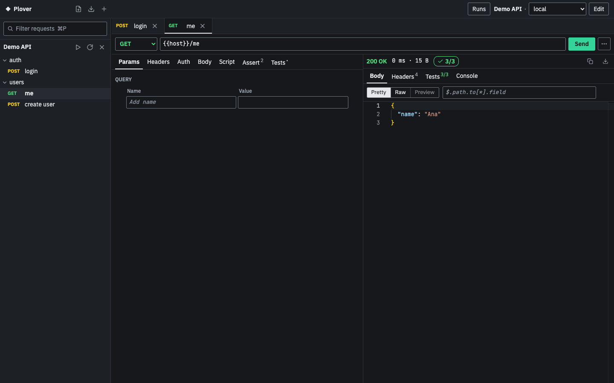
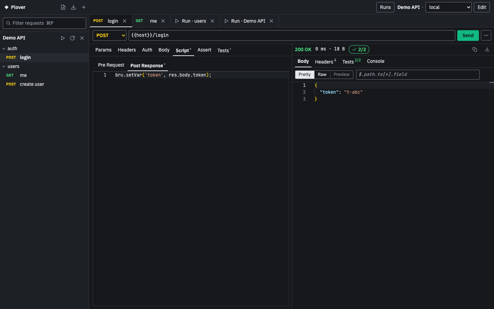
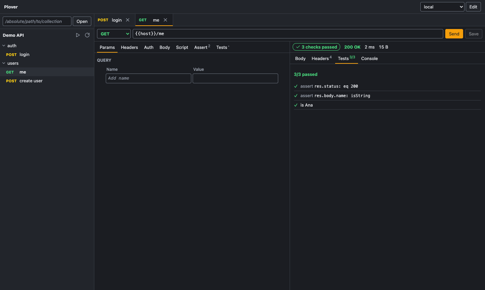
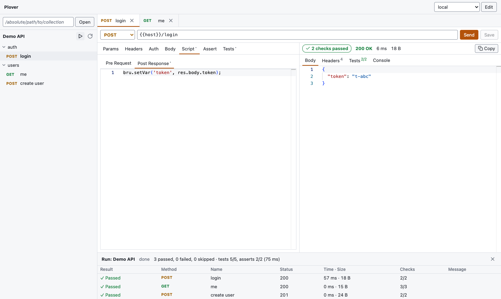

# Plover

A fast, local API client that opens [Bruno](https://github.com/usebruno/bruno)
collections (`.bru` files) as they are and saves them with minimal diffs. One Rust
core, three ways to use it:

- **`plv run`**: run a collection, folder or request from the command line (CI).
- **`plv serve`**: local web UI on `127.0.0.1`, embedded in the same binary.
- **Plover desktop**: Tauri app (macOS, Windows, Linux) with a native folder picker
  and secrets in the OS keychain.

All HTTP requests are sent by the Rust backend, never by the browser. No CORS
limits, and no data leaves your machine except the requests you send.



| Post-response script | Tests and asserts |
|---|---|
|  |  |



## Usage

```bash
plv run path/to/collection --env local
plv run path/to/collection/folder/request.bru --env local --env-var token=abc
plv serve path/to/collection          # opens the browser (single-use launch code in the URL)
plv serve --no-open --port 4000       # prints a URL with the session token, for copying
```

```text
$ plv run demo-api --env local
✓ POST    login  200  53ms  18B
    ✓ login ok
    ✓ token present
✓ GET     me  200  1ms  15B
    ✓ assert res.status: eq 200
    ✓ assert res.body.name: isString
    ✓ is Ana
✓ POST    create user  201  0ms  24B
    ✓ created
    ✓ id stored
Requests: 3 passed, 0 failed, 0 skipped · Tests: 5/5 · Asserts: 2/2 (99ms)
```

`run` exits 0 when every request passed (HTTP 4xx/5xx is not a failure, as in
Bruno), 1 when a request failed to send or a test, assert or script failed, and
2 on usage or load errors. Files that cannot be parsed are skipped with a
warning, like Bruno's CLI.

Reports, secrets and script limits:

```bash
plv run coll --env local --reporter-junit out/junit.xml --reporter-json out/results.json
plv run coll --env local --verbose                  # also print script console.* output
plv run coll --env local --use-keychain             # read secrets saved by the UI/desktop app
plv run coll --script-timeout-ms 10000 --script-memory-mb 64
plv run coll --env Dev --delay 7000                  # wait between requests (rate limits)
plv run coll --env Dev --reporter-html out/report.html   # offline, self-contained HTML
```

**Replacing `bru run`.** Existing `bru run` commands work with `plv run` for these flags:

| Bruno flag | In Plover |
|---|---|
| `--env`, `--env-var`, `--insecure`, `--verbose`, `--delay`, `--reporter-junit`, `--reporter-json`, `--reporter-html` | Supported, same meaning |
| `-r` / `--recursive` | Accepted; Plover always runs folders recursively (Bruno without `-r` runs only a folder's direct requests) |
| `--sandbox safe` | Accepted; Plover always runs scripts like Bruno's safe mode. `--sandbox developer` is rejected. |
| `--bail`, `--tests-only`, `--tags`, `--exclude-tags`, `--env-file`, `--global-env`, `--csv-file-path`, `--json-file-path`, `--iteration-count`, `--parallel`, `--cacert`, `--client-cert-config`, `--noproxy`, `-o`/`--format`, `--reporter-skip-*`, `--disable-cookies` | Not supported yet: `plv` stops with an "unexpected argument" error (exit 2) rather than ignoring them |

In the web UI and the desktop app, **+** next to the Plover name (`⌘/Ctrl+O`) opens a
collection: paste a path, pick a recent one, or browse (desktop). **Collections are
remembered**: the next `plv serve` or app launch reopens them with their open tabs,
expanded folders and selected environment (unsaved edits are not kept). A collection
whose folder moved or was deleted shows as unavailable with Retry and Remove; × on a
collection closes it (it stays under Recent). This state lives in `state.json` in
`~/Library/Application Support/Plover` (macOS), `%APPDATA%\Plover` (Windows) or
`~/.config/plover` (Linux), or in `PLOVER_STATE_DIR`; it holds paths and layout only,
never secrets. `plv run` does not use it.

Shortcuts: `⌘/Ctrl+O` open collection, `⌘/Ctrl+P` filter requests (`Esc` clears),
`⌘/Ctrl+Enter` send, `⌘/Ctrl+S` save, arrow keys in the sidebar tree and tab strips,
`Esc` closes dialogs. `⌘/Ctrl+W` closes a request tab in the desktop app (browsers
keep that shortcut for closing the window).

## Desktop app

The desktop app starts the same local server and UI inside a native window.

- **File → Open Collection…** (`⌘/Ctrl+O`) and **Browse for folder…** under **+**
  use the native folder picker. Opened collections come back on the next launch.
- **Secrets** (`vars:secret` values) are stored in the OS keychain. If the
  keychain is unavailable or access is denied, that secret stays in memory and
  the UI says so. Secrets are never written to `.bru` files.
- **File → Open in Browser** opens the same session in your browser with a
  single-use code, so the session token stays out of the browser history.
- **Install Command Line Tool…** (macOS, Linux) links `plv` to the app binary,
  so one install gives you the app, the web UI and the CLI.

Builds are unsigned for now: on first launch macOS asks you to confirm in
*System Settings → Privacy & Security*, and Windows SmartScreen shows a warning.

## Scripts and tests

`script:pre-request`, `script:post-response`, `tests`, `assert` and
`vars:post-response` run like Bruno's **safe mode** (QuickJS), in Bruno's order
(collection → folders → request; post-response scripts and tests from the request
outwards unless `bruno.json` sets `"scripts": { "flow": "sequential" }`).

| Supported | Not supported yet (throws `… is not supported by Plover yet`) |
|---|---|
| `bru`: get/set/has/delete for runtime, env and collection vars (any JSON value), `getFolderVar`, `getRequestVar`, `interpolate`, `getEnvName`, `getCollectionName`, `getProcessEnv`, `cwd`, `sleep`, `sendRequest`, `cookies` / `cookies.jar()`, `setNextRequest`, `runner.skipRequest/stopExecution/setNextRequest` | `bru.runRequest`, global environments, OAuth2 helpers |
| `req`: URL, method, headers, body, timeout, max redirects (get/set), `getName`, `getAuthMode` | `req.onFail`, `req.getPathParams`, `req.getTags`, `req.getExecutionMode`, `req.disableParsingResponseJson`; reading/replacing multipart bodies |
| `res`: `status`, `statusText`, `headers`, `body`, `responseTime`, `res('a.b[0]')`, `getSize`, `setBody` | `res.jq`, extra function arguments to `res(...)` |
| `test()`, `expect`/`assert` (chai 4 + Bruno's `json`, `jsonSchema`, `jsonBody`), all 28 assert operators | — |
| `require`: `chai`, `buffer`, `moment`, `btoa`, `atob`, `crypto-js`, `tv4`, `ajv`, `ajv-formats`, `uuid`, `nanoid`, `jsonwebtoken`, `path` (`resolve`), `axios` (sent through Plover's backend); `setTimeout`/`setInterval` | Any other module (`fs`, npm packages, local `require('./x')`): the request fails with `Cannot find module 'x'`. Bruno's developer mode is not supported. |

`{{process.env.NAME}}` and `bru.getProcessEnv` read the process environment,
overridden by the collection's `.env` file, as in Bruno. Like Bruno 4.3, variable
changes made by scripts are written back to the environment file after each
request (secrets excepted).

Limits: 30 s per script phase and 128 MiB per script runtime by default. A
script that exceeds them fails its request, and the run continues.

## Performance

Measured on macOS (Apple silicon) against a local mock server, compared with
Bruno CLI 4.3.0 in safe mode (details in [docs/phase-3-report.md](docs/phase-3-report.md)):

| 1000 requests | Bruno CLI | Plover |
|---|---|---|
| no scripts | 2.54 s · 420 MB RAM | 0.17 s · 14 MB RAM |
| one script + one test each | 128.7 s · 432 MB RAM | 2.3 s · 33 MB RAM |

| Download / install size (macOS arm64) | |
|---|---|
| `plv` with web UI | 12.8 MB |
| `plv` CLI-only (`--no-default-features`) | 7.6 MB |
| `Plover.app` / `.dmg` | 16.4 MB / 6.3 MB |

## Status

All four planned phases are built: core + CLI, local server + web UI, scripts and
tests, and the desktop app. CI runs on macOS, Windows and Linux; check the latest run before relying on a platform. See
[docs/PRD.md](docs/PRD.md) and the phase reports in [docs/](docs/) for scope,
verification and known gaps.

## Building

See [docs/development.md](docs/development.md). `scripts/build-release.sh` builds
`target/release/plv` with the web UI embedded; `cargo build --release -p plover-cli
--no-default-features` builds the CLI-only `plv`; the desktop bundles are built
with `npm ci && npx tauri build` in `crates/desktop`.

## License

MIT — see [LICENSE](LICENSE). Test fixtures under `fixtures/bruno-tests/` come from [Bruno](https://github.com/usebruno/bruno) (MIT, see `fixtures/bruno-tests/LICENSE`). Plover is not affiliated with Bruno.
