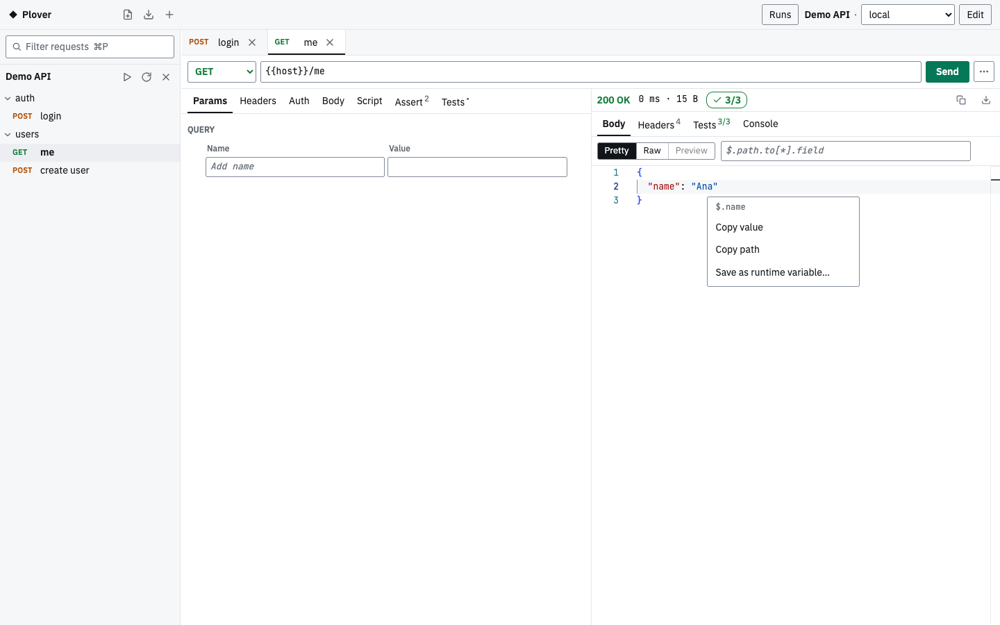
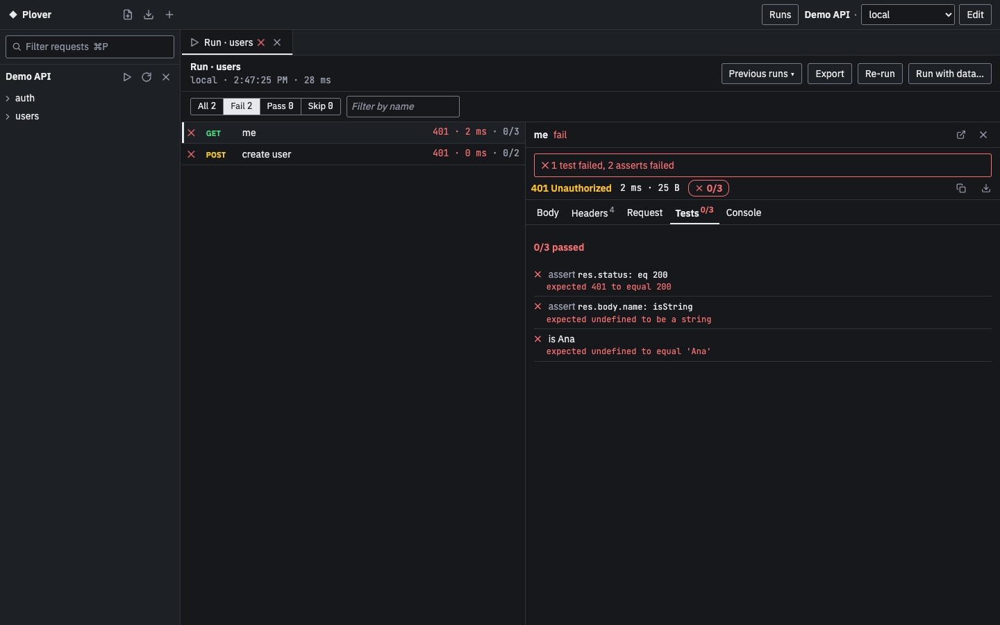

# Plover

A fast, local API client that opens [Bruno](https://github.com/usebruno/bruno)
collections (`.bru` files) as they are and saves them with minimal diffs. One Rust
core, three ways to use it:

- **`plv run`**: run a collection, folder or request from the command line (CI).
- **`plv serve`**: local web UI on `127.0.0.1`, embedded in the same binary.
- **Plover desktop**: Tauri app (macOS, Windows, Linux) with a native folder picker
  and secrets in the OS keychain.

All HTTP requests are sent by the Rust backend, never by the browser. No CORS
limits, and no data leaves your machine except the requests you send.


| Post-response script | Tests and asserts |
|---|---|
|  |  |

| Value menu on a JSON response | A run tab filtered to failures |
|---|---|
|  |  |


## Install

Download from [Releases](https://github.com/tien-le-mesoneer/Plover/releases):

- **CLI** `plv`: `plv-<version>-macos-universal.tar.gz`, `-linux-x64.tar.gz` or
  `-windows-x64.zip`. Unpack and put `plv` on your `PATH`.
- **Desktop app**: `.dmg` (macOS), `.exe` installer (Windows), `.deb` or `.AppImage` (Linux).
  The `.deb` also installs `plv`.

Builds are not signed. On macOS, right-click the app and choose **Open** the first time
(for `plv`: `xattr -d com.apple.quarantine plv`); on Windows, choose **More info → Run
anyway**. `SHA256SUMS` in each release lists the checksums.

## Usage

```bash
plv run path/to/collection --env local
plv run path/to/collection/folder/request.bru --env local --env-var token=abc
plv serve path/to/collection          # opens the browser (single-use launch code in the URL)
plv serve --no-open --port 4000       # prints a URL with the session token, for copying
```

```text
$ plv run demo-api --env local
✓ POST    login  200  53ms  18B
    ✓ login ok
    ✓ token present
✓ GET     me  200  1ms  15B
    ✓ assert res.status: eq 200
    ✓ assert res.body.name: isString
    ✓ is Ana
✓ POST    create user  201  0ms  24B
    ✓ created
    ✓ id stored
Requests: 3 passed, 0 failed, 0 skipped · Tests: 5/5 · Asserts: 2/2 (99ms)
```

`run` exits 0 when every request passed (HTTP 4xx/5xx is not a failure, as in
Bruno), 1 when a request failed to send or a test, assert or script failed, and
2 on usage or load errors. Files that cannot be parsed are skipped with a
warning, like Bruno's CLI.

Reports, secrets and script limits:

```bash
plv run coll --env local --reporter-junit out/junit.xml --reporter-json out/results.json
plv run coll --env local --verbose                  # also print script console.* output
plv run coll --env local --use-keychain             # read secrets saved by the UI/desktop app
plv run coll --script-timeout-ms 10000 --script-memory-mb 64
plv run coll --env Dev --delay 7000                  # wait between requests (rate limits)
plv run coll --env Dev --reporter-html out/report.html   # offline, self-contained HTML
plv run coll --env Dev --reporter-json r.json --reporter-skip-headers Cookie --reporter-skip-body
```

Reports include each request as sent and each response (headers and body), shaped like
Bruno's JSON report; the HTML report has a collapsible section per request. Secrets are
masked as `***` first (see **Run history** below), unlike Bruno, which writes them raw.

**Run history.** Every run is saved, from `plv run` and from the app, so you can look at
what was sent and received afterwards:

```bash
plv runs coll                                       # newest first: ID, start (UTC), source, env, counts
plv runs show 20261024T091500Z-4kq2xa --reporter-html out/again.html   # print it and rebuild reports
plv runs clear coll --yes                           # delete this collection's runs
plv run coll --no-history                           # do not save this run
```

In the app, ▶ on a collection or folder opens the run in a **Run tab**. **All | Fail |
Pass | Skip** filters the results (with a name filter beside it); click a row to see its
Body, Headers, Request, Tests and Console, with the failure reason first. **Previous
runs ▾** lists saved runs (app and `plv`) and shows one in the same tab.

- Where: `runs/` next to `state.json` (below), never inside the collection, one folder
  per collection. The 20 newest runs per collection are kept.
- CI: `plv run` does not save when `CI` is set (to anything but empty, `0` or `false`);
  `--history` saves anyway, `--no-history` never saves. "Saved run <id>" goes to stderr.
- Bodies: each request and response body keeps at most 1 MiB, and one run at most
  50 MiB of bodies; later bodies are marked "not kept". File uploads keep only the
  file name.
- Masking, before anything is saved or reported, in two passes:
  - **by name**: credential-named values (the column names listed under data-driven
    runs below) are masked whole, whatever their length or type, in JSON bodies (a
    number becomes `"***"`), XML elements and attributes (`<wsse:Password>` counts),
    form fields, multipart text parts and URL query values (also `key`);
  - **by value**: the values of `Authorization`, `Proxy-Authorization`, `Cookie`,
    `Set-Cookie` and token headers such as `X-Api-Key` (and the token after
    `Bearer `/`Basic `, and cookie values), every secret of the environment, every
    credential found by name (4 characters or more) and every JWT are replaced with
    `***` wherever they appear in the run: URLs, headers, bodies, console, test and
    assert messages. A login token returned in a body is masked there too.
  Limits:
  - header-derived values shorter than 8 characters, and secrets shorter than 4, are
    not searched for elsewhere; a number or a 1–3 character credential is masked only
    next to its name (so `***` does not spread over `200` or `2024`);
  - only the exact text is matched, not URL-encoded, base64 or JSON-escaped forms;
  - binary (non-UTF-8) bodies are not searched; values from `process.env` are not masked.

**Data-driven runs.** Run a collection or folder once per row of a CSV or JSON file, or
a number of times, with Bruno CLI's flags:

```bash
plv run coll --env local --csv-file-path rows.csv      # one iteration per row
plv run coll --env local --json-file-path rows.json    # an array of objects
plv run coll --env local --iteration-count 5           # five times, no file
```

- `{{column}}` reads the current row in URLs, headers, bodies and assert right-hand
  sides, above runtime variables (as in Bruno); `bru.getVar` and `bru.interpolate` do
  not see row values. Scripts get `bru.runner.iterationData` (`get`, `set`, `has`,
  `unset`, `stringify`), `bru.runner.iterationIndex` and `bru.runner.totalIterations`.
- Runtime variables and cookies carry over between iterations; `--delay` is not applied
  after the last request of an iteration; `setNextRequest(null)` ends one iteration and
  `stopExecution()` ends the run.
- The file path is relative to the current directory. A file sets the count to its
  rows; `--iteration-count` with a file prints `--iteration-count ignored: …`.
- Unlike Bruno, which runs nothing and exits 0, these stop with exit 2 before anything is
  sent: a missing file, zero rows, a file over 16 MiB, a JSON top level that is not an
  array of objects, a CSV row with the wrong number of fields (`rows.csv:7: expected 4
  fields, found 3`), or both file flags together.
- `--parallel` is accepted but iterations still run one after another (with a warning).
- Values of credential-named columns (`password`, `passwd`, `client_secret`, `secret`,
  `token`, `access_token`, `refresh_token`, `id_token`, `api_key`, `apikey`,
  `assertion`, `client_assertion`) are masked everywhere: history, reports, `--verbose`
  output and the app. Numbers and values shorter than 4 characters are masked by name
  (the column, a JSON key, a form field), not where they appear without their name.
- Reports: the JSON report has one `{ iterationIndex, summary, results }` entry per
  iteration (like Bruno); the HTML report has an "Iteration N of M" section with the
  row; JUnit stays one flat list with Bruno's suite names.

In the app, **Run with data…** in the Run tab header takes a CSV/JSON file (shown as its row
count and column names only, never kept) or an iteration count; results are grouped by
iteration. **Export** in the Run tab header saves a finished, cancelled or saved run as
HTML, JSON or JUnit, byte for byte what `plv runs show <id> --reporter-*` writes (the
desktop app uses a save dialog).

**Replacing `bru run`.** Existing `bru run` commands work with `plv run` for these flags:

| Bruno flag | In Plover |
|---|---|
| `--env`, `--env-var`, `--insecure`, `--verbose`, `--delay`, `--reporter-junit`, `--reporter-json`, `--reporter-html` | Supported, same meaning |
| `--csv-file-path`, `--json-file-path`, `--iteration-count` | Supported, same meaning; broken or empty files stop with exit 2 (see **Data-driven runs**) |
| `--parallel` | Accepted; iterations run one after another |
| `--reporter-skip-all-headers`, `--reporter-skip-headers <NAME>…`, `--reporter-skip-request-body`, `--reporter-skip-response-body`, `--reporter-skip-body` | Supported, same meaning (applied after masking) |
| `-r` / `--recursive` | Accepted; Plover always runs folders recursively (Bruno without `-r` runs only a folder's direct requests) |
| `--sandbox safe` | Accepted; Plover always runs scripts like Bruno's safe mode. `--sandbox developer` is rejected. |
| `--bail`, `--tests-only`, `--tags`, `--exclude-tags`, `--env-file`, `--global-env`, `--cacert`, `--client-cert-config`, `--noproxy`, `-o`/`--format`, `--disable-cookies` | Not supported yet: `plv` stops with an "unexpected argument" error (exit 2) rather than ignoring them |

In the web UI and the desktop app, **+** next to the Plover name (`⌘/Ctrl+O`) opens a
collection: paste a path, pick a recent one, or browse (desktop). **Collections are
remembered**: the next `plv serve` or app launch reopens them with their open tabs,
expanded folders and selected environment (unsaved edits are not kept). A collection
whose folder moved or was deleted shows as unavailable with Retry and Remove; × on a
collection closes it (it stays under Recent). This state lives in `state.json` in
`~/Library/Application Support/Plover` (macOS), `%APPDATA%\Plover` (Windows) or
`~/.config/plover` (Linux), or in `PLOVER_STATE_DIR`; it holds paths and layout only,
never secrets. `plv run` reads and writes only its `runs/` folder.

**From curl, scratch requests and HAR files** (UI only):

- Paste a `curl …` command into the URL bar and it fills method, URL, query, headers,
  body, basic auth and multipart fields. Options Plover cannot copy (`-k`, proxies,
  client certificates, `--resolve`, unknown flags) are listed in the banner, never
  dropped silently; **Undo** restores the request, and **Move to secret** stores a
  pasted `Authorization` or `Cookie` value as a secret of the selected environment.
- **New request** (above the sidebar) opens an unsaved tab that sends with the
  collection's headers, auth and scripts. It is never written to disk until you save it
  into a folder, and is not remembered across restarts.
- **Cancel:** while a request runs, Send becomes `Cancel · 3.2s` (or press `Esc`). The
  server stops the request and any script at once; a cancelled send keeps no variable
  changes (cookies already received stay).
- **Variables:** `{{name}}` in the URL, params, headers, auth and body is tinted when
  defined, dotted amber when a script sets it later (`bru.setVar`, `vars:post-response`)
  and wavy red when no scope defines it. Hover it, or leave the caret in it for half a
  second, to see its value and scope (`Environment: Dev`, `Runtime`, …) and what it
  overrides. Secrets, `process.env` values and values sent in an `Authorization` or
  `Cookie` header are shown as `•••• secret`; scripts never run for this.
- **Quick open** (`⌘/Ctrl+K`, also inside editors): find any request of the open
  collections by name, folder or collection; case and accents do not matter
  (`dang nhap` finds `Đăng nhập`). An empty search lists the requests you opened.
- **Send** is the only coloured button. **⋯** next to it holds Copy as cURL (as written,
  or with variables filled in for the selected environment; it asks first when the
  command contains a secret), Copy resolved URL (secret values as `***`), Save and
  Reveal .bru file (desktop) / Copy file path (browser). A dot on a tab means unsaved.
- **Response:** Pretty / Raw / Preview (HTML in a sandboxed frame, images, PDF), a
  JSONPath filter (`$.items[*].id`, `..id`; Copy body then copies the result), `⌘/Ctrl+F`
  to search, and a click (or Enter) on a JSON value to copy it, copy its path, or keep
  it as a runtime variable. `x-request-id`, `traceparent` and `location` are pinned
  under the body with a copy button. Bodies over 1 MiB render in part (Show all);
  Copy and Save always use the whole body.
- **Sidebar width:** drag its edge (or focus it and use the arrow keys); double-click
  resets it. The width is remembered.
- **Import HAR** (above the sidebar, or right-click a folder or the collection name, or
  Shift+F10 on a folder) turns a recorded browser session into requests and moves
  every credential into secret variables, including passwords and tokens inside XML
  and text bodies; the request sent is byte-identical to the captured one. See
  [Capture a browser flow and import it](docs/capture-with-claude.md).
- **Runtime variables** (`{x}` next to the environment): the values scripts and Save as
  variable set, credentials shown as `••••`; remove one, or Clear all (asks first).

Shortcuts: `⌘/Ctrl+O` open collection, `⌘/Ctrl+K` quick open, `⌘/Ctrl+P` filter
requests (`Esc` clears), `⌘/Ctrl+Enter` send, `Esc` cancel a running send or run, `⌘/Ctrl+S` save, `⌘/Ctrl+F` search the response body, Enter on a
JSON value for its menu, arrow keys in the sidebar tree and tab strips,
`Esc` closes dialogs. `⌘/Ctrl+W` closes a request tab in the desktop app (browsers
keep that shortcut for closing the window).

## Desktop app

The desktop app starts the same local server and UI inside a native window.

- **File → Open Collection…** (`⌘/Ctrl+O`) and **Browse for folder…** under **+**
  use the native folder picker. Opened collections come back on the next launch.
- **Secrets** (`vars:secret` values) are stored in the OS keychain. If the
  keychain is unavailable or access is denied, that secret stays in memory and
  the UI says so. Secrets are never written to `.bru` files.
- **File → Open in Browser** opens the same session in your browser with a
  single-use code, so the session token stays out of the browser history.
- **Install Command Line Tool…** (macOS, Linux) links `plv` to the app binary,
  so one install gives you the app, the web UI and the CLI.

Builds are unsigned for now: on first launch macOS asks you to confirm in
*System Settings → Privacy & Security*, and Windows SmartScreen shows a warning.

## Scripts and tests

`script:pre-request`, `script:post-response`, `tests`, `assert` and
`vars:post-response` run like Bruno's **safe mode** (QuickJS), in Bruno's order
(collection → folders → request; post-response scripts and tests from the request
outwards unless `bruno.json` sets `"scripts": { "flow": "sequential" }`).

| Supported | Not supported yet (throws `… is not supported by Plover yet`) |
|---|---|
| `bru`: get/set/has/delete for runtime, env and collection vars (any JSON value), `getFolderVar`, `getRequestVar`, `interpolate`, `getEnvName`, `getCollectionName`, `getProcessEnv`, `cwd`, `sleep`, `sendRequest`, `cookies` / `cookies.jar()`, `setNextRequest`, `runner.skipRequest/stopExecution/setNextRequest` | `bru.runRequest`, global environments, OAuth2 helpers |
| `req`: URL, method, headers, body, timeout, max redirects (get/set), `getName`, `getAuthMode` | `req.onFail`, `req.getPathParams`, `req.getTags`, `req.getExecutionMode`, `req.disableParsingResponseJson`; reading/replacing multipart bodies |
| `res`: `status`, `statusText`, `headers`, `body`, `responseTime`, `res('a.b[0]')`, `getSize`, `setBody` | `res.jq`, extra function arguments to `res(...)` |
| `test()`, `expect`/`assert` (chai 4 + Bruno's `json`, `jsonSchema`, `jsonBody`), all 28 assert operators | — |
| `require`: `chai`, `buffer`, `moment`, `btoa`, `atob`, `crypto-js`, `tv4`, `ajv`, `ajv-formats`, `uuid`, `nanoid`, `jsonwebtoken`, `path` (`resolve`), `axios` (sent through Plover's backend); `setTimeout`/`setInterval` | Any other module (`fs`, npm packages, local `require('./x')`): the request fails with `Cannot find module 'x'`. Bruno's developer mode is not supported. |

`{{process.env.NAME}}` and `bru.getProcessEnv` read the process environment,
overridden by the collection's `.env` file, as in Bruno. Like Bruno 4.3, variable
changes made by scripts are written back to the environment file after each
request (secrets excepted).

Limits: 30 s per script phase and 128 MiB per script runtime by default. A
script that exceeds them fails its request, and the run continues.

## Performance

Measured on macOS (Apple silicon) against a local mock server, compared with
Bruno CLI 4.3.0 in safe mode (details in [docs/phase-3-report.md](docs/phase-3-report.md)):

| 1000 requests | Bruno CLI | Plover |
|---|---|---|
| no scripts | 2.54 s · 420 MB RAM | 0.17 s · 14 MB RAM |
| one script + one test each | 128.7 s · 432 MB RAM | 2.3 s · 33 MB RAM |

| Download / install size (macOS arm64) | |
|---|---|
| `plv` with web UI | 12.8 MB |
| `plv` CLI-only (`--no-default-features`) | 7.6 MB |
| `Plover.app` / `.dmg` | 16.4 MB / 6.3 MB |

## Status

All four planned phases are built: core + CLI, local server + web UI, scripts and
tests, and the desktop app. CI runs on macOS, Windows and Linux; check the latest run before relying on a platform. See
[docs/PRD.md](docs/PRD.md) and the phase reports in [docs/](docs/) for scope,
verification and known gaps.

## Building

See [docs/development.md](docs/development.md). `scripts/build-release.sh` builds
`target/release/plv` with the web UI embedded; `cargo build --release -p plover-cli
--no-default-features` builds the CLI-only `plv`; the desktop bundles are built
with `npm ci && npx tauri build` in `crates/desktop`.

## License

MIT — see [LICENSE](LICENSE). Test fixtures under `fixtures/bruno-tests/` come from [Bruno](https://github.com/usebruno/bruno) (MIT, see `fixtures/bruno-tests/LICENSE`). Plover is not affiliated with Bruno.
